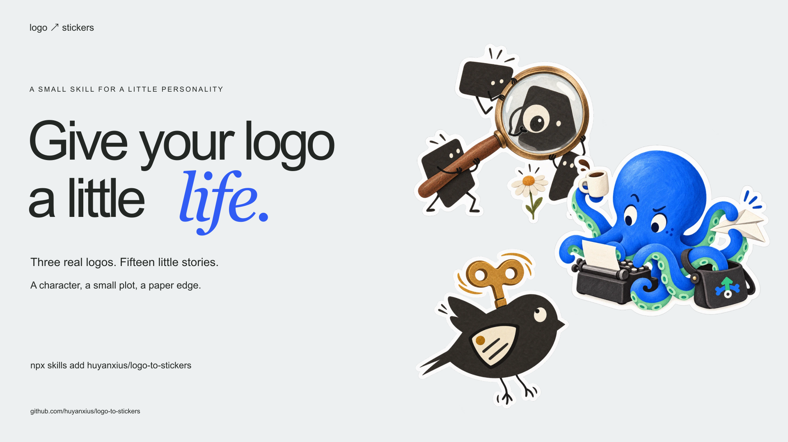

# Logo to Stickers

[中文](README.zh-CN.md) · [Live gallery](https://huyanxius.github.io/logo-to-stickers/) · [The skill](SKILL.md) · [Example PNGs](https://github.com/huyanxius/logo-to-stickers/releases/latest)



A small skill for turning a logo into a character with something to do.

It grew out of a night spent making stickers for a portfolio. The early attempts were stiff. Things started working when the brand itself supplied the cast, the ability, and the small things that could go wrong.

The three sets below are actual outputs from that session. The repository includes the original marks, all fifteen scenes, the generation prompts, and the method that connects them.

## Try it

```sh
npx skills add huyanxius/logo-to-stickers
```

Give your agent a logo and ask:

```text
Use $logo-to-stickers to make five playful paper stickers from this logo.
Keep the brand recognisable, give each image a little story, and save
five separate transparent PNGs.
```

Tested with **Codex's built-in image generator**. The skill is a set of instructions, references, and examples. Your agent needs an image-generation tool that accepts reference images and produces transparent output; installing the skill does not add an image model to an agent that lacks one.

The [Skills CLI](https://github.com/vercel-labs/skills) supports multiple agent hosts. You can inspect the package without installing it:

```sh
npx skills add huyanxius/logo-to-stickers --list
```

For a manual Codex installation, clone the repository into a new folder at `~/.codex/skills/logo-to-stickers`. In another agent, use that agent's skill directory. If a folder is already present, inspect it before replacing anything.

## Three marks, fifteen little stories

### Qunxue — the shapes become the cast

Four uneven charcoal fragments become four paper researchers. They inspect a daisy, build a wobbly ladder, interview each other through paper cups, and get tangled in the relationships they are studying.


### MultiPush — the idea becomes an ability

Multi-platform publishing becomes a many-armed postal writer. The blue, mint, and small arrow mark stay recognisable. The arms do the work and occasionally cause the trouble.


### Windup — the actual mark gets moving

The mechanical bird keeps its split tail and inset wing. An overenthusiastic winding key, a troublesome animation strip, and an impractically large paper wing give it a day of its own.


[Explore every scene in the gallery →](https://huyanxius.github.io/logo-to-stickers/)

## What the skill pays attention to

| Decision | What it changes |
| --- | --- |
| Read the real mark | Keep the shapes, component count, or colour relationship that makes the brand recognisable. |
| Choose a translation | Let logo parts become a cast, or turn a product behaviour into a character's ability. |
| Give the character a situation | Use an action, a small consequence, and a reaction that survives at thumbnail size. |
| Keep one identity across a set | Reuse the first successful sticker as a character reference while changing the action. |
| Finish it as paper | Matte printed colour, a narrow white die-cut edge, and actual alpha outside the sticker. |

There is room for different drawing styles. Qunxue uses cut-paper and ink; MultiPush has more gouache volume. A physical sticker edge does not require every character to become a glossy 3D toy.

## Inside

- [SKILL.md](SKILL.md) — the reusable workflow.
- [Worked examples](references/design-method.md) — how the three brands were translated.
- [Prompt recipe](references/prompt-template.md) — reference roles, character identity, one scene, paper finish.
- [Actual run records](examples/prompts.json) — fifteen stories and prompts with their reference order.
- [Gallery](docs/index.html) — a static, dependency-free viewer with the original marks and every scene.

The gallery images are compressed display copies. Original-sized transparent PNGs are in the [release downloads](https://github.com/huyanxius/logo-to-stickers/releases/latest). Prompt-requested dimensions and actual generator output dimensions can differ; inspect the saved files.

## Work on it locally

```sh
python3 scripts/validate.py
python3 -m http.server 4173 --directory docs
```

Open `http://localhost:4173`. The site has no build step. [Contributions](CONTRIBUTING.md) with real marks, real outputs, and a clear design decision are welcome.

## License

Skill instructions, documentation, and site code: [MIT](LICENSE). Example brand identities and artwork: see [attribution and usage notes](NOTICE.md).
