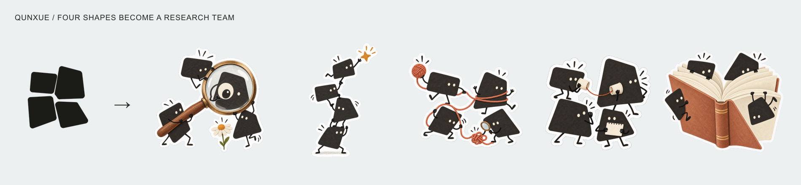
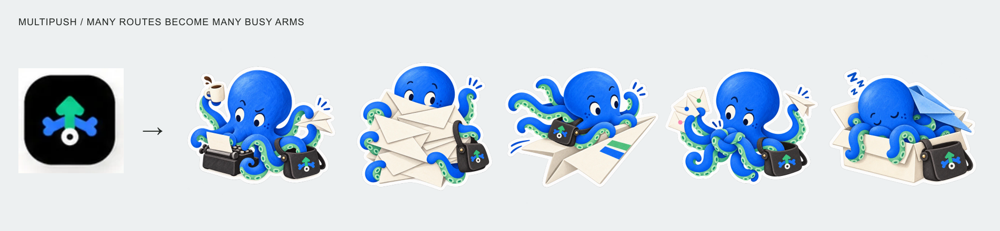
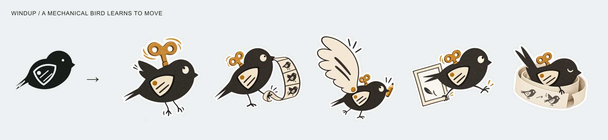

# Logo to Stickers

[English](README.md) · [在线画廊](https://huyanxius.github.io/logo-to-stickers/) · [技能正文](SKILL.md) · [透明 PNG 示例](https://github.com/huyanxius/logo-to-stickers/releases/latest)

<p align="center">
  <a href="https://huyanxius.github.io/logo-to-stickers/"></a>
</p>

十秒看完原 Logo 与已有生成结果的对照。[播放 MP4](https://github.com/huyanxius/logo-to-stickers/releases/download/v1.0.0/logo-day-job.mp4)。

给一个 Logo，做出一套认得出品牌、也看得出角色在忙什么的纸质贴纸。

这套方法来自一个晚上做个人主页的过程。最初几轮很僵，角色拿着道具站在那里，看不出有什么意思。后来，群学的四块图形成了四位研究员，MultiPush 的多路发布成了忙不过来的多手邮差，Windup 的机械小鸟则被自己的动作帧绊住了。

这里放的就是那晚实际做出的三套图，每套五张。原 Logo、生成结果、实际提示词和提取出的 skill 都在仓库里。

## 安装和使用

```sh
npx skills add huyanxius/logo-to-stickers
```

把 Logo 或项目里的品牌素材交给支持图片生成的代理，然后说：

```text
用 $logo-to-stickers 给这个项目做 5 张成套纸质贴纸。
保留品牌特征，每张有一个小情境，分别保存成透明 PNG。
```

本次实际出图使用的是 **Codex 内置图片生成工具**。这个仓库提供的是方法、指令和参考素材；代理本身还需要能接收参考图、输出透明图片的生成工具。安装 skill 不会给原本不能画图的工具增加图片模型。

使用 [Skills CLI](https://github.com/vercel-labs/skills) 可以选择安装到兼容的代理。只想检查包里有什么，可以先运行：

```sh
npx skills add huyanxius/logo-to-stickers --list
```

也可以把整个仓库克隆进 Codex 的 `~/.codex/skills/logo-to-stickers`，其他代理使用对应的技能目录。已有同名目录时，先查看内容再决定如何更新。

## 今晚的三个真实例子

### 群学：四块 Logo 成了一个研究小队

保留四块歪歪的黑色图形，添上很少的眼睛和手脚，让它们一起干活。四个人认真地研究一朵小花、叠起来够星星、用纸杯电话做访谈，还会被正在研究的关系线绕住。



### MultiPush：多路发布变成八只忙碌的手

从一个内容要发往多个平台，想到一个多手的邮差。蓝色、薄荷绿和包上的箭头标记连回品牌。它可以同时打字、折飞机和拿咖啡，但信封还是会把自己埋住，触手也会打结。



### Windup：从机械小鸟本身重新开始

前一版围着女巫角色转，效果不对。重做时回到真正使用的机械小鸟标志，留下分叉尾巴、带两道斜线的翅膀，给它加一把发条钥匙。它把自己拧上天、被动作条绊住、画出过大的纸翅膀，最后睡进纸条做的小窝。



## Skill 里保留了什么

先从品牌里找到可辨认的形状、颜色和一个具体动作，再决定角色怎样长出来。每张图写清楚谁在做什么，出了什么小意外，角色怎样回应。第一张检查过的图成为整套的角色参考，后面改变动作和构图，脸、比例和笔触保持一致。

纸质感来自印刷、纸面和薄白边。图案可以用剪纸、墨线或水粉，也可以有适度体积。白边沿整个小场景的轮廓走，外面保留真正的透明区域。

写提示词时，还要把原 Logo、角色参考、纸边参考各自的用途说清楚。这样换一个品牌时，画法可以借鉴，原来的章鱼、纸片人和道具不会一起被带过去。

## 文件

- [技能正文](SKILL.md)：可复用的完整流程。
- [三个案例怎么转化](references/design-method.md)：原图形、角色能力和小情境之间的关系。
- [提示词配方](references/prompt-template.md)：四块可填写的结构。
- [实际生成记录](examples/prompts.json)：十五张的情节、提示词和传图顺序。
- [在线画廊源码](docs/index.html)：无需构建，直接运行的静态页面。

画廊使用压缩后的展示图，原尺寸透明 PNG 放在 [Release](https://github.com/huyanxius/logo-to-stickers/releases/latest)。生成工具实际返回的尺寸可能和提示词里的要求不同，交付前要检查文件本身。

## 本地查看

```sh
python3 scripts/validate.py
python3 -m http.server 4173 --directory docs
```

浏览器打开 `http://localhost:4173`。欢迎带着实际图形、生成结果和具体修改判断来[贡献案例](CONTRIBUTING.md)。

技能、文档和页面代码采用 [MIT](LICENSE)；示例品牌及图像的使用说明见 [NOTICE](NOTICE.md)。
